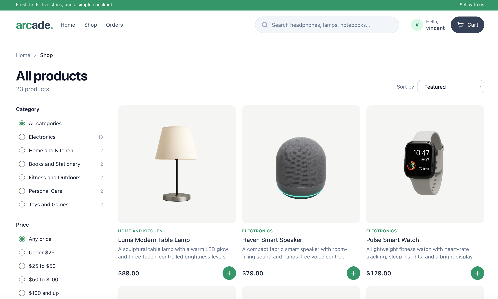
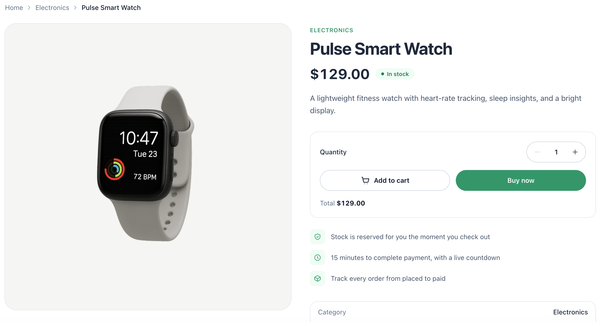
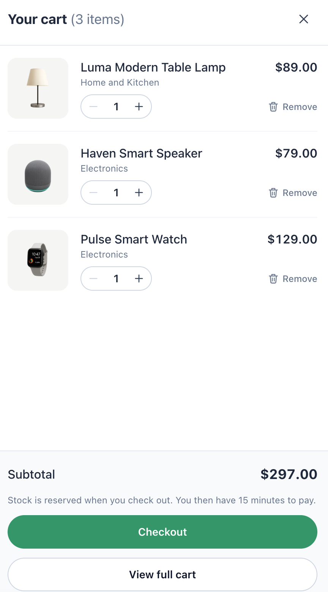
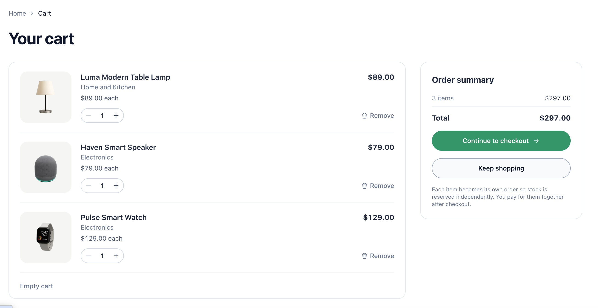
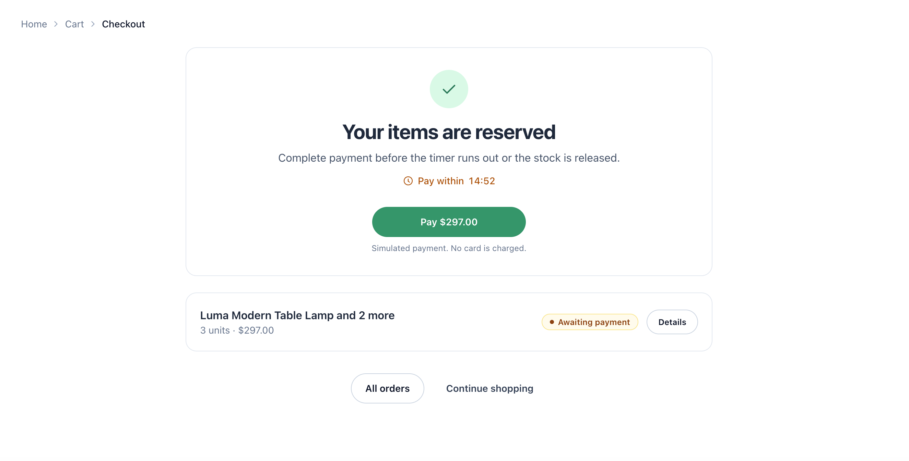
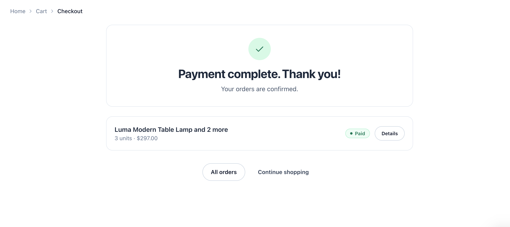
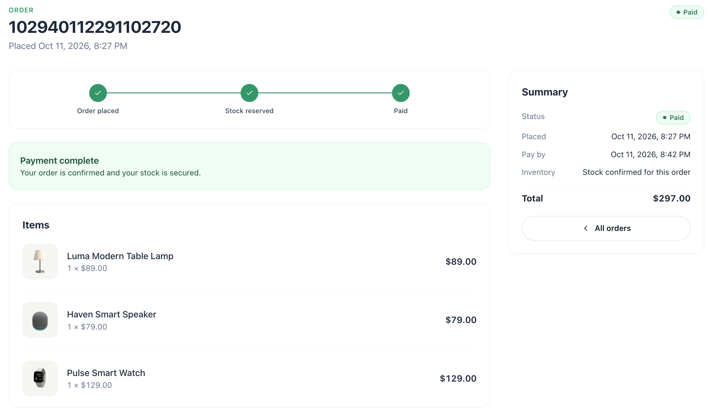

# E-Commerce Platform

A e-commerce app with a Next.js storefront and four Spring Boot services: Gateway, Catalog, Inventory, and Order. The backend demonstrates Consul discovery, load-balanced OpenFeign calls, Kafka/outbox workflows, Elasticsearch search, Redis Lua inventory reservations, and two-shard order storage.

## UI Design

The storefront uses a clean, responsive shopping flow from product discovery through inventory reservation, simulated payment, and order tracking.

<table>
  <tr>
    <td width="50%">
      <strong>Product catalog</strong><br>
      
    </td>
    <td width="50%">
      <strong>Product details</strong><br>
      
    </td>
  </tr>
  <tr>
    <td width="50%">
      <strong>Cart drawer</strong><br>
      
    </td>
    <td width="50%">
      <strong>Full cart</strong><br>
      
    </td>
  </tr>
  <tr>
    <td width="50%">
      <strong>Reserved checkout</strong><br>
      
    </td>
    <td width="50%">
      <strong>Payment complete</strong><br>
      
    </td>
  </tr>
</table>

### Order tracking



## Run it

Requires Docker Compose. From the repository root:

```bash
./scripts/local.sh start all
```

Open the storefront at `http://localhost:8084` or the [interactive API docs](docs/api/README.md) at `http://localhost:8085`. Use `./scripts/local.sh smoke` to verify the buyer flow and `./scripts/local.sh stop` to stop containers without deleting data. For a live Next.js development server on port 3000, use `./scripts/local.sh dev`. The [setup guide](docs/getting-started.md) covers prerequisites and test commands.

## Where to look

| Location | Responsibility |
| --- | --- |
| `frontend/` | Next.js storefront and UI tests |
| `backend/gateway-service/` | Public API routing and rate limits |
| `backend/catalog-service/` | Products, categories, search indexing |
| `backend/inventory-service/` | Durable stock and Redis reservations |
| `backend/order-service/` | Checkout, order events, payment simulation, sharded orders |
| `backend/service-common/` | Shared technical primitives, not a deployable service |
| `deploy/local/` | Compose and container builds |
| `deploy/aws/` | Runnable TypeScript CDK/CloudFormation deployment |

Within each service, start at `api` (HTTP), then the `I*Service` contract and implementation in `application` (use cases), `domain` (business state), and `infrastructure` (MyBatis, Redis, Kafka, Feign, or Elasticsearch). Repository interfaces remain at the application boundary.

Read the [project structure guide](docs/architecture/project-structure.md) for module responsibilities and the [Swagger UI guide](docs/api/README.md) to try the current API. The local login is username-only for demonstration; it is not production authentication. The [AWS deployment guide](deploy/aws/README.md) explains how a clone can provision the EC2-based architecture in its own account. The CDK code synthesizes successfully, but no live AWS deployment or performance benchmark is claimed by this repository.
